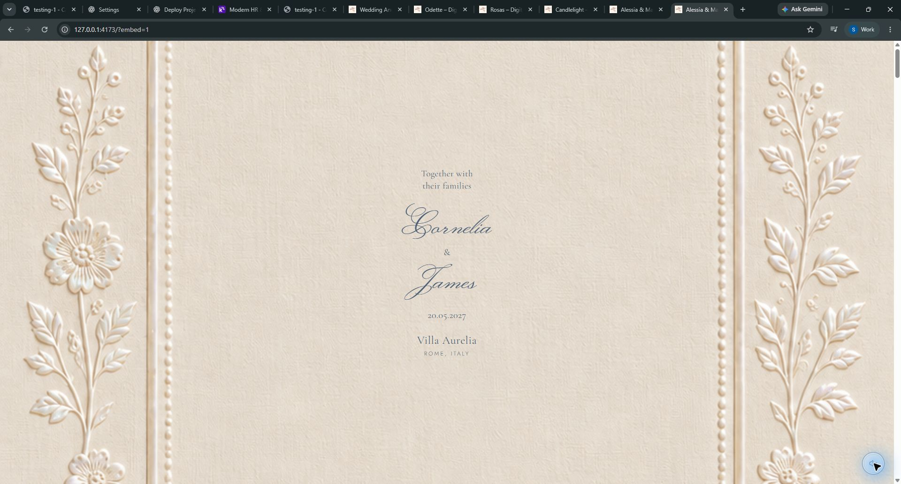

# Angel Wedding Invitation & Website

An interactive digital wedding invitation with wax seal animation, background music, event schedule, countdown timer, travel & venue guide, and RSVP form.



---

## 🚀 Quick Start

### Prerequisites
- [Node.js](https://nodejs.org/) (v18 or higher)
- No `npm install` needed—the distribution is self-contained with all assets and fonts bundled locally.

### Run Locally

1. Start the local server:
   ```bash
   npm start
   ```

2. Open your browser and navigate to:
   ```
   http://127.0.0.1:4173/?embed=1
   ```

3. **Click the wax seal** on the envelope to open the interactive invitation.

### Verify Assets
To check the integrity of all bundled assets, videos, and fonts:
```bash
npm run check
```

---

## 📁 Project Structure

```
├── mother-of-pearl/
│   ├── dist/                 # Pre-built static site (HTML, JS, CSS, fonts, audio, video)
│   │   ├── assets/           # Bundled styles, compiled scripts, and local fonts
│   │   ├── __l5e/assets-v1/  # High-resolution illustrations, envelope video & music
│   │   └── index.html        # Main entrypoint
│   ├── scripts/
│   │   ├── serve.mjs         # Zero-dependency local development server
│   │   └── verify.mjs        # Integrity check script for assets
│   ├── asset-manifest.json   # Inventory of copied media assets
│   └── package.json
├── package.json              # Root workspace scripts (npm start, npm run check)
└── reference.html            # Layout reference
```

---

## 🌐 Deploy to the Web

### Vercel
1. Import this repository into [Vercel](https://vercel.com).
2. Set **Output Directory** to `mother-of-pearl/dist`.
3. Click **Deploy**.

### Netlify
1. Import this repository into [Netlify](https://netlify.com).
2. Set **Publish directory** to `mother-of-pearl/dist`.
3. Click **Deploy**.

---

## 📄 License
Private wedding invitation project.
